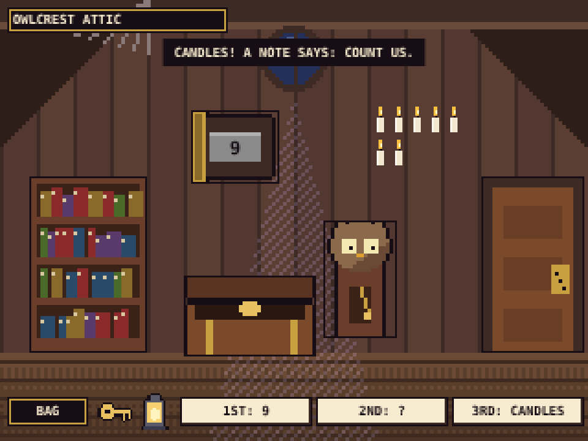
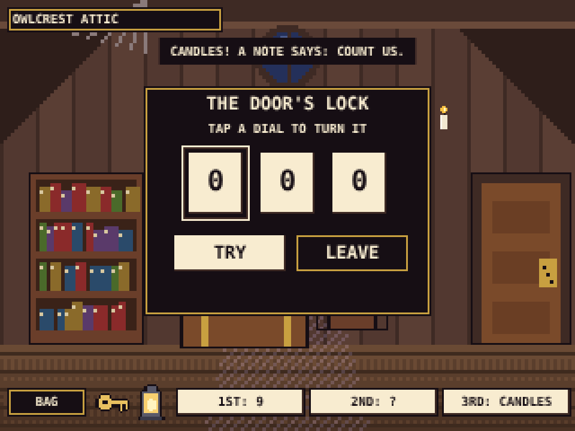
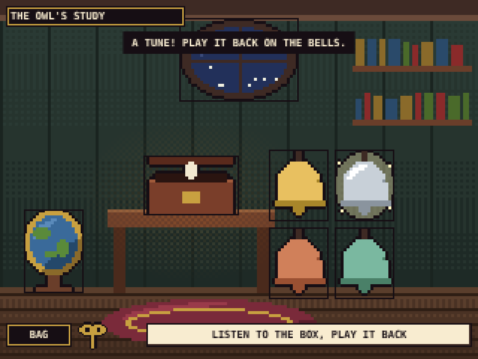

# Owlcrest Attic

A two-room point-and-click escape. Crack the attic door's code from three clues, then play the owl's tune back on four bells in the study below. The code and tune are new every play. Made with [GameBean Studio](https://github.com/icakinser/gamebean-studio).

## Play

- **In a browser:** download `index.html` and open it. On a phone, just tap.
- **In GameBean Studio:** **FILE > Open…** > **Browse this computer…** and pick `owlcrest-attic-cartridge.json` (or `index.html`) to open it in the editor. It is also under **Full games** in **FILE > New Game…**.

The controls are listed under **Controls in the finished game** below.

| | |
| --- | --- |
|  |  |
|  |  |

---

## Build it yourself

**Owlcrest Attic** is a point-and-click escape room. You are locked in a dusty attic. Tap things to search them: pull books from the shelf, open the old trunk, look behind the painting, listen to the owl clock and light the dark corner. Three clues give the three digits of the door's lock. Below it waits **the Owl's study**: find the winding key, wind the music box and play its tune back on four bells to open the skylight. **The code and the tune are new every play.**


It shows off:

- **Random number** and **Calculate** that roll a fresh code (`code = c1 * 100 + c2 * 10 + c3`).
- Hotspots: **Buttons** placed in the level, with **If / Else** rules on what you carry.
- A **For loop** that counts up to a **variable** (`h`), so the owl hoots a different number of times each game.
- **Object variables**: nine candles that each show when `n <= c3`, and a trunk that remembers it is open.
- A **Panel** that pauses the game with three dials turned by `(d1 + 1) % 10`, and a **formula condition** that checks the code.
- A second room with a **memory tune**: a For loop plays four random notes, and each bell checks a formula against the note you are on.
- Its **own title and You win screens**, a Music maker song and seven Sound maker sounds.

**What you will learn:** how to hide clues behind other clues, and how a few variables make a puzzle that is different every time.

**Time:** about 40 minutes.

---

## Before you start

### Learn the editor moves

If you have not used the GameBean Studio editor before, read **[GameBean Studio editor basics](EDITOR-BASICS.md)** first. The moves you will repeat most:

| The tutorial says                  | You do                                                                                                                    |
| ---------------------------------- | ------------------------------------------------------------------------------------------------------------------------- |
| **Place a Spikes**                 | Toolbox > **OBJECTS** tab > click **Spikes** > click the map > click **DONE** ([§8](EDITOR-BASICS.md#8-place-an-object))  |
| **Name it X, at `8, 4, 200 × 16`** | Type the name, then X, Y, W and H ([§9](EDITOR-BASICS.md#9-name-an-object-and-type-its-position-and-size))                |
| **Remove Hazard**                  | Click the **×** on the Hazard card ([§10](EDITOR-BASICS.md#10-bean-cards-turn-off-reorder-remove-and-change-settings))    |
| **Add Button (Actions)**           | **ADD ACTION** > type "Button" > click **Button** ([§11](EDITOR-BASICS.md#11-add-a-bean))                                 |
| **Sprite `name/idle.png`**         | **SPRITE** > **IMPORT PNG / SHEET** > pick the file > **SAVE SPRITE** ([§15](EDITOR-BASICS.md#15-sprites-import-or-draw)) |
| **`WHEN On click / tap · DO …`**   | **ADVANCED** > **ADD LOGIC RULE** ([§14](EDITOR-BASICS.md#14-rules-when--do-))                                            |

Every object in this game is a **Spikes** with its **Hazard** bean removed, used as a plain thing to look at, tap or carry rules. A **UI object** below means exactly that: a Spikes, Hazard removed, with a **see-through sprite** (SPRITE > clear every pixel, or set its look to none) and the Screen UI bean named.

### Get the sprite files

The pictures are in [`sprites/owlcrest-attic`](sprites/owlcrest-attic): `attic/idle.png` (the backdrop), `bookshelf/idle.png`, `painting/idle.png` and `open.png`, `owl-clock/idle-1.png` and `idle-2.png`, `trunk/idle.png` and `open.png`, `darkness/idle.png`, `candle/idle-1.png` and `idle-2.png`, `door/idle.png` and `open.png`, `key/idle.png`, `lantern/idle.png`; and for the study `study/idle.png`, `skylight/idle.png` and `open.png`, `globe/idle.png` and `spin-1.png` to `spin-4.png`, `music-box/idle.png` and `open.png`, `bell-1` to `bell-4` (`idle.png` and `lit.png`) and `winding-key/idle.png`.

### Keep the finished game open for comparison

**FILE > New Game…** > **OWLCREST ATTIC** (under Full games) in a second window.

### Controls in the finished game

| Key or touch | Does                        |
| ------------ | --------------------------- |
| Tap a thing  | Search it                   |
| Tap a dial   | Turn it one number on       |
| B            | Close the lock (like LEAVE) |
| Enter        | Pause                       |

---

## Part 1: Set up the game

1. **BUILD** > **FILE > New Game…** > **BLANK GAME**. Name the scene **OWLCREST ATTIC**, 320 × 240.
2. **LEVEL SETTINGS**: **CAMERA** = **Fixed**, **SKY** = **Night**, **HORIZON** = **None**, **INTRO** = `FIND THE CODE`.
3. A palette **Owlcrest**: Ink `#160e14`, Dark `#3e2a24`, Light `#c8a040`, Paper `#f8ecd0`.
4. **VARIABLES**:

| Slot | Name       | Start | Holds                                |
| ---- | ---------- | ----- | ------------------------------------ |
| 1    | `c1`       | 0     | The code's first digit (1-9)         |
| 2    | `c2`       | 0     | The second digit (0-6)               |
| 3    | `c3`       | 0     | The third digit (1-9)                |
| 4    | `code`     | 0     | The whole code                       |
| 5    | `h`        | 0     | How many times the owl hoots         |
| 6    | `key`      | 0     | 1 once you have the key              |
| 7    | `lantern`  | 0     | 1 once you have the lantern          |
| 8    | `searched` | 0     | Books pulled out                     |
| 9    | `d1`       | 0     | The first dial                       |
| 10   | `d2`       | 0     | The second dial                      |
| 11   | `d3`       | 0     | The third dial                       |
| 12   | `tries`    | 0     | Times you pressed TRY                |
| 13   | `unlocked` | 0     | 1 once the door is open              |
| 14   | `hoot`     | 0     | The For loop's counter               |
| 15   | `s1`       | 0     | The study tune's first note (1-4)    |
| 16   | `s2`       | 0     | Its second note                      |
| 17   | `s3`       | 0     | Its third note                       |
| 18   | `s4`       | 0     | Its fourth note                      |
| 19   | `step`     | 0     | Which note of the tune you play next |
| 20   | `k`        | 0     | The music box's For loop counter     |
| 21   | `note`     | 0     | The note the box plays this round    |
| 22   | `spins`    | 0     | Times the globe was spun             |
| 23   | `windkey`  | 0     | 1 once you have the winding key      |
| 24   | `heard`    | 0     | 1 once the box has played its tune   |
| 25   | `free`     | 0     | 1 once the skylight is open          |

5. **SOUNDS**: Sound 1 **Hoot** (a long **Blip**, Sine wave, low pitch), Sound 2 **Creak** (a slow **Hit**, Saw wave), Sound 3 **Clunk** (a low **Hit**), and Sounds 4 to 7 **Chime 1** to **Chime 4** (a long **Blip**, Sine wave, each a little higher). **MUSIC**: a quiet song **Dust and Moonlight** (tempo 76, **PLAYS AS** = **Song 1 + Main theme**).
6. The **Hero**: name it **Pointer**, at `304, 224, 12 × 16`, remove all its beans, see-through sprite.

---

## Part 2: The attic and the Keeper

1. **Attic**: a **Spikes** at `0, 0, 320 × 240`, Hazard removed, sprite `attic/idle.png`.
2. **Title**: UI object at `4, 4, 120 × 14`, **Label** (Small, Left, Dark box). UI TEXT `OWLCREST ATTIC`.
3. **Keeper**: UI object at `0, 0, 16 × 16`. Add **Environment settings**: **Top bar** = **Hide**.
   - `WHEN On start`:
     - **Show text** `LOCKED IN THE ATTIC! LOOK AROUND.`
     - **Random number** `c1` 1 to 9, `c2` 0 to 6, `c3` 1 to 9
     - **Calculate** `code` = `c1 * 100 + c2 * 10 + c3`
     - **Calculate** `h` = `c2 + 3`

_A new code every time:_ Random number draws fresh numbers each time the game starts, so no two attics have the same code.

---

## Part 3: Hotspots

Every thing you can search is a **hotspot**: a **Spikes**, Hazard removed, with a **Button** (Small, Look **Outline**, Send its text as a message = No, Click sound = No, **Place** = **In the level (scrolls)**) and no UI TEXT.

1. **Bookshelf**: hotspot at `16, 96, 64 × 96`, sprite `bookshelf/idle.png`. Rule `WHEN On click / tap`:
   - **Add to variable** `searched` 1
   - **If / Else**, IF `key = 1`: **Show text** `JUST DUSTY BOOKS ABOUT OWLS.`
   - ELSE: **If / Else**, IF `searched >= 3`: **Set variable** `key` 1, **Play sound** (pickup), **Show text** `A BRASS KEY FELL OUT OF A BOOK!`, **Send message** `bag`. ELSE: **Show text** `NOTHING IN THIS ONE. KEEP LOOKING.`
2. **Trunk**: hotspot at `100, 150, 72 × 44`, animations **idle** `trunk/idle.png` and **open** `trunk/open.png`. **OBJECT VARIABLES**: `open` 0. Rule `WHEN On click / tap`:
   - **If / Else**, IF `open = 1`: **Show text** `THE TRUNK IS EMPTY NOW.`
   - ELSE: **If / Else**, IF `key = 1`: **Set variable** `open` 1, **Set variable** `lantern` 1, **Play animation** (open), **Play sound** (ui, **Creak**), **Show text** `AN OLD LANTERN! IT STILL LIGHTS.`, **Send message** `bag`. ELSE: **Show text** `LOCKED. IT NEEDS A KEY.`

> **Check:** **PLAY**. Tap the shelf three times for the key, then the trunk.

---

## Part 4: The three clues

**Clue 1, behind the painting**

1. **Painting**: hotspot at `104, 60, 48 × 40`, animations **idle** `painting/idle.png` and **open** `painting/open.png`. Rule `WHEN On click / tap · DO Play animation (open), Play sound (ui, Creak), Show text (A NUMBER IS SCRATCHED BEHIND IT!), Send message (clue1)`.
2. **First digit**: UI object at `112, 72, 32 × 18`, **Label** (Medium, Centre, Dark text, Place In the level). UI TEXT `{c1}`. Rules `WHEN On start · DO Show / hide (hide)` and `WHEN On message (clue1) · DO Show / hide (show)`.

**Clue 2, the owl clock**

3. **Owl clock**: hotspot at `176, 120, 40 × 64`, sprite `owl-clock/idle-1.png` and `idle-2.png`. Rule `WHEN On click / tap`:
   - **Send message** `clue2`
   - **Show text** `A TAG ON THE OWL: TAKE AWAY 3.`
   - **For loop**: counter `hoot`, from **1**, to **`h`** (type the variable's name in the TO box), step 1. Inside: **Play sound** (ui, **Hoot**), **Show text** `HOO! ({hoot})` (0.6 s), **Wait** 0.6.

The owl hoots `c2 + 3` times, so the player counts the hoots and takes away 3.

**Clue 3, the dark corner**

4. **Candle 1**: a **Spikes** at `204, 58, 6 × 14`, Hazard removed, sprite `candle/idle-1.png` and `idle-2.png` (FRAME TIME 0.3). **OBJECT VARIABLES**: `n` 1. Rules `WHEN On start · DO Show / hide (hide)` and `WHEN On message (light) · IF formula (n <= c3) · DO Show / hide (show)`.
5. Copy it eight times: **Candle 2** to **Candle 9**, with `n` 2 to 9. Five in the top row (x 204, 214, 224, 234, 244, y 58) and four below (x 204, 214, 224, 234, y 76).
6. **Dark corner**: hotspot at `198, 52, 60 × 42`, sprite `darkness/idle.png`. It sits over the candles. Rule `WHEN On click / tap`: **If / Else**, IF `lantern = 1`: **Send message** `light`, **Show text** `CANDLES! A NOTE SAYS: COUNT US.`, **Send message** `clue3`, **Show / hide** (hide). ELSE: **Show text** `TOO DARK TO SEE THIS CORNER.`

---

## Part 5: The notebook and the bag

Along the bottom of the screen:

1. **Bag label**: UI object at `4, 216, 44 × 16`, **Label** (Small, Centre, Dark box). UI TEXT `BAG`.
2. **Key in bag**: a **Spikes** at `52, 214, 20 × 20`, Hazard removed, sprite `key/idle.png`. Rules `WHEN On start · DO Show / hide (hide)` and `WHEN On message (bag) · IF formula (key = 1) · DO Show / hide (show)`.
3. **Lantern in bag**: the same at `74, 214`, sprite `lantern/idle.png`, IF `lantern = 1`.
4. **Clue 1**: UI object at `98, 216, 72 × 16`, **Label** (Small, Centre, **Light box**). UI TEXT `1ST: ?`. Rule `WHEN On message (clue1) · DO Set text (1ST: {c1})`.
5. **Clue 2** at `172, 216`, UI TEXT `2ND: ?`, on `clue2` **Set text** `2ND: HOOTS - 3`.
6. **Clue 3** at `246, 216`, UI TEXT `3RD: ?`, on `clue3` **Set text** `3RD: CANDLES`.

---

## Part 6: The door and its lock

1. **Door**: hotspot at `262, 96, 56 × 96`, animations **idle** `door/idle.png` and **open** `door/open.png`.
   - `WHEN On click / tap`: **If / Else**, IF `unlocked = 1`: **Play sound** (checkpoint), **Go to level** (the study, once you have made it). ELSE: **Send message** `lock`.
   - `WHEN On message (unlocked) · DO Play animation (open)`.
2. **Lock panel**: UI object at `80, 48, 160 × 128`, **Panel** (Panel number 1, Dark window, Starts open **No**, While open = **Game pauses, B closes it**). UI TEXT `THE DOOR'S LOCK`. Rules `WHEN On message (lock) · DO Show / hide (show)` and `WHEN On message (unlocked) · DO Show / hide (hide)`.
3. **Lock words**: `88, 66, 144 × 12`, **Label** (Small, Centre, Light text). UI TEXT `TAP A DIAL TO TURN IT`.
4. **Dial 1**: `104, 84, 32 × 36`, **Button** (**Large**, Light, Send its text as a message = No). UI TEXT `{d1}`. Rule `WHEN On click / tap · DO Calculate (d1 = (d1 + 1) % 10)`. **Dial 2** at `144, 84` (`d2`) and **Dial 3** at `184, 84` (`d3`).
5. **Try button**: `96, 130, 64 × 22`, **Button** (Medium, Light, Send its text as a message = No). UI TEXT `TRY`. Rule `WHEN On click / tap`:
   - **Add to variable** `tries` 1
   - **If / Else**, IF `d1 * 100 + d2 * 10 + d3 = code`: **Set variable** `unlocked` 1, **Play sound** (ui, **Creak**), **Show text** `CLICK! THE DOOR SWINGS OPEN.`, **Send message** `unlocked`. ELSE: **Play sound** (ui, **Clunk**), **Show text** `CLUNK. THAT'S NOT IT.`
6. **Leave button**: `164, 130, 64 × 22`, **Button** (Medium, Dark, Send its text as a message = No, **Panel** = **Close the panel it's on**). UI TEXT `LEAVE`.

_Why `% 10`?_ It is the remainder after dividing by 10, so 9 + 1 wraps round to 0, just like a real dial.


---

## Part 7: The Owl's study

1. **+ NEW SCENE**: **THE OWL'S STUDY**, 320 × 240, Fixed camera, Night sky, Owlcrest palette, INTRO `PLAY THE OWL'S TUNE`. Point the attic Door's **Go to level** here.
2. **Study**: a **Spikes** at `0, 0, 320 × 240`, Hazard removed, sprite `study/idle.png`. **Title** (copy it from the attic) with UI TEXT `THE OWL'S STUDY`.
3. **Keeper**: UI object at `0, 0, 16 × 16`, **Environment settings** (Top bar Hide). `WHEN On start`: **Show text** `DOWN THE STAIRS: THE OWL'S STUDY.`, then **Random number** `s1`, `s2`, `s3` and `s4`, each 1 to 4.
4. **Globe**: hotspot at `16, 140, 40 × 56`, animations **idle** `globe/idle.png` and **spin** `globe/spin-1.png` to `spin-4.png`. Rule `WHEN On click / tap`:
   - **Add to variable** `spins` 1, **Play animation** (spin), **Wait** 0.6, **Play animation** (idle)
   - **If / Else**, IF `windkey = 0 and spins >= 3`: **Set variable** `windkey` 1, **Play sound** (pickup), **Show text** `A WINDING KEY RATTLED OUT!`, **Send message** `bag`. ELSE: **If / Else**, IF `windkey = 0`: **Show text** `SOMETHING RATTLES INSIDE...`
5. **Bag label** (copy it) and **Winding key in bag**: a **Spikes** at `52, 214, 20 × 20`, sprite `winding-key/idle.png`, rules `WHEN On start · DO Show / hide (hide)` and `WHEN On message (bag) · DO Show / hide (show)`.
6. **Tune label**: UI object at `98, 216, 218 × 16`, **Label** (Small, Centre, Light box). UI TEXT `LISTEN TO THE BOX, PLAY IT BACK`.
7. **Bell 1**: hotspot at `180, 100, 40 × 48`, animations **idle** `bell-1/idle.png` and **lit** `bell-1/lit.png`. **OBJECT VARIABLES**: `n` 1. Three rules:
   - `WHEN On message (ring1) · DO Play animation (lit), Play sound (ui, Chime 1), Wait (0.45), Play animation (idle)`.
   - `WHEN On click / tap`: the same four actions, so a tap rings it too.
   - `WHEN On click / tap`: **If / Else**, IF `heard = 1 and free = 0`:
     - **If / Else**, IF `n = if(step = 1, s1, if(step = 2, s2, if(step = 3, s3, s4)))`: **Add to variable** `step` 1, then **If / Else**, IF `step >= 5`: **Set variable** `free` 1, **Send message** `free`, **Show text** `THE SKYLIGHT SWINGS OPEN!`
     - ELSE: **Set variable** `step` 1, **Play sound** (hit), **Show text** `A WRONG NOTE. START AGAIN.`
8. Copy it three times: **Bell 2** at `224, 100`, **Bell 3** at `180, 152`, **Bell 4** at `224, 152`, each with its own `bell-N` sprite, `n`, message `ringN` and **Chime N**.
9. **Music box**: hotspot at `96, 104, 64 × 40` (on the desk), animations **idle** `music-box/idle.png` and **open** `music-box/open.png`. Rule `WHEN On click / tap`: **If / Else**, IF `windkey = 1`:
   - **Play animation** (open), **Set variable** `heard` 1, **Set variable** `step` 1, **Show text** `A TUNE! PLAY IT BACK ON THE BELLS.`
   - **For loop**: counter `k`, from 1 to 4, step 1. Inside: **Calculate** `note` = `if(k = 1, s1, if(k = 2, s2, if(k = 3, s3, s4)))`, **Select case** on `note` (CASE 1 **Send message** `ring1` … CASE 4 `ring4`), **Wait** 0.8.
   - ELSE: **Show text** `A MUSIC BOX. IT NEEDS WINDING.`
10. **Skylight**: hotspot at `120, 12, 80 × 56`, animations **idle** `skylight/idle.png` and **open** `skylight/open.png`.
    - `WHEN On click / tap`: **If / Else**, IF `free = 1`: **Play sound** (win), **Win / lose the game** (win, `OUT OF OWLCREST!`). ELSE: **Show text** `THE SKYLIGHT IS SHUT TIGHT.`
    - `WHEN On message (free) · DO Play animation (open)`.



_Why `if(step = 1, s1, ...)`?_ A formula can't pick "variable number `step`", so the nested `if` picks the right one of `s1` to `s4` for you. The music box uses the same trick with `k`.

---

## Part 8: The You win screen

When the game is won, its own You win screen stands in for the built-in one. Each of these has **Appears** = **Only on the You win screen**:

1. **Win panel**: `48, 52, 224 × 136`, **Panel** (Panel number 7, Look **Light window**, Starts open Yes, Appears = Only on the You win screen). UI TEXT `YOU ESCAPED!`.
2. **Win words**: `56, 76, 208 × 52`, **Label** (Small, Centre, Look **Dark text**, Appears = Only on the You win screen). UI TEXT:

   ```
   THE DOOR'S CODE WAS {code}: {tries} TRIES.
   THE OWL'S TUNE OPENED THE SKY.

   OUT OVER THE ROOFTOPS YOU GO.
   ```

3. **Again button**: `96, 150, 128 × 24`, **Button** (Medium, Look **Dark**, Send its text as a message = No, **Game** = **Start / resume / play again**, Appears = Only on the You win screen). UI TEXT `NEW ATTIC`.

Build these in the **study** only.

---

## Part 9: The title screen

The game shows its own title screen instead of the built-in one. Three UI objects make it, each with its bean's **Appears** setting = **Only on the title screen**:

1. **Title screen**: `32, 40, 256 × 160`, **Panel** (Panel number 8, Look **Dark window**, Starts open Yes, **Appears** = Only on the title screen). UI TEXT `OWLCREST ATTIC` (a Panel shows its text as a title along its top).
2. **Title words**: `40, 72, 240 × 64`, **Label** (Medium, Centre, Look **Light text**, Appears = Only on the title screen). UI TEXT:

   ```
   LOCKED IN! TAP THINGS TO SEARCH,
   CRACK THE DOOR'S CODE, THEN FIND
   THE WAY OUT OF THE OWL'S STUDY.
   ```

3. **Play button**: `112, 156, 96 × 26`, **Button** (Medium, Look **Dark**, Send its text as a message = No, **Game** = **Start / resume / play again**, Appears = Only on the title screen). UI TEXT `PLAY`.

Because they only appear on the title screen, they never get in the way while you play.

Build these in the **attic** only, as it is the first.

---

## Part 10: Play it

1. **PLAY**, then **PLAY** on the title screen. Look around and tap things.
2. Pull books until the key falls out, open the trunk, take the lantern to the dark corner and count the candles.
3. Look behind the painting, then tap the owl clock and count its hoots. Take away 3.
4. Tap the door, turn the dials to your three digits and press **TRY**. Tap the open door to go down to the study.
5. Spin the globe until the key falls out, wind the music box and watch which bells light up. Play them back in the same order, then tap the open skylight.

> **If something is off:** the code is always 0? The Keeper's On start must roll it. The owl never hoots? The For loop's TO must be the variable `h`, not a number. The candles don't light? Each needs its own `n`, and they must sit under the Dark corner, not over it.

---

## Make it your own

- **A longer tune:** add `s5`, a fifth round in the For loop and `step >= 6`.
- **A fourth digit:** `c4`, a fourth dial, `code = c1 * 1000 + c2 * 100 + c3 * 10 + c4` and a new clue to find it.
- **Harder searching:** raise `searched >= 3` so the key hides deeper in the shelf.
- **A timer:** count down with a rule timer and lose when it reaches 0.
